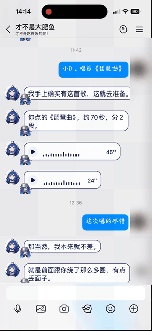

<p align="center"></p>

<p align="center">
  <a href="https://github.com/26YZT/xiaod-qq/actions"></a>
  <a href="LICENSE"></a>
  
  
</p>

# 小D · 鲸鱼娘 QQ 伙伴

把一只嘴硬心软、爱惦记白饭的小鲸鱼娘接进 QQ：能私聊、看懂群聊的接话时机、记住本群的事，关键时刻发语音和表情，也能带着伴奏唱歌。

这是基于 **AstrBot + NapCat** 的可复现整合包，包含自定义插件、角色卡、世界书、固定 L 音色、安装工具及经过验证的第三方插件快照。使用者填写**自己的** QQ、群号和 API Key，再扫码登录；不会共享维护者的账号、聊天记录或记忆。

**[安装指南](docs/INSTALL.md) · [功能与配置](docs/CONFIGURATION.md) · [常见问题](docs/FAQ.md) · [来源与许可](docs/THIRD_PARTY.md)**

## 看看实际效果

下面是维护者提供的真实 QQ 录屏，真人头像已做模糊处理。GIF 无声，完整 MP4 保留演示声音。

<p align="center">
  <a href="assets/media/qq-demo.mp4"></a>
</p>

<p align="center"><a href="assets/media/qq-demo.mp4">▶ 打开 23 秒完整演示视频</a></p>

## 已经串起来的能力

| 能力 | 初始配置 |
| --- | --- |
| 角色与世界书 | 小D角色卡、10组预设对话、8条按话题触发的补充设定；均可在 AstrBot 修改 |
| 群聊接话 | 不必每次 @；结合当前角色、说话人、引用对象和最近话题判断，避免认领别人的对话 |
| 群聊记忆 | 近期群文字与事实摘要独立保存；只记当前群，不导入维护者历史 |
| 私聊主动联系 | 仅联系配置的主人；2～4小时低频，23:00～09:00安静，无人回应不连续追发 |
| 日常语音 | MiMo 固定 L 参考声线；私聊关键时刻偶尔语音，群聊仅在明确要求时语音 |
| 语音发送 | 使用同一份正文合成，失败回退同一份文字；避免先发一套文字、再念另一套内容 |
| 表情 | 合适时少量发送；附一张小D欢迎表情，可继续导入自己的图片包 |
| 自动点歌 | 找可获取的公开音源 → 分离人声和伴奏 → L 声线转换 → 同调混音 → QQ 分段发送与缓存 |
| 联网 | 使用配置的 DeepSeek 搜索工具；模型必须保留 `tool_use` 能力 |
| 动态与签名 | 提供独立、受限的定时模块，**默认关闭**；先预览、确认桥接支持和可见范围后再开启 |

### 唱歌与说话使用不同后端

日常说话由 **MiMo voiceclone** 提供；唱歌使用 **Seed-VC + 本地伴奏分离**。默认 L 参考音频固定，不训练，不把 TTS 朗读当成原曲演唱。

唱歌沿用已试听确认的方案 2：**50步、CFG 0.5、升3个半音、原速度**，伴奏同步调整调性。L 为 MiMo 文字设计生成的声线；另附 C/F/G/H/I 参考收藏，来源分别见[素材说明](assets/ASSET-LICENSE.md)。

## 快速开始

优先支持 **macOS Apple Silicon**，这是维护者实际运行和验收的平台。Linux 可运行基础框架；Linux/CUDA 完整唱歌链路尚无本项目的独立硬件验收。Windows 暂不提供已验证的启动器。

先准备：Docker Desktop/Engine、`uv`、Git、FFmpeg/ffprobe、Node.js 22+，以及可用的 DeepSeek 和 MiMo API Key。完整唱歌环境首次需下载数 GB 模型，建议预留 **12 GB** 磁盘空间。

```bash
git clone https://github.com/26YZT/xiaod-qq.git
cd xiaod-qq
./xiaod install --singing
./xiaod init
./xiaod start
```

Mac 也可先阅读安装说明，再双击 `install.command` 按提示安装配置，之后双击 `start.command`。

1. 在 `init` 提示中填写托管号、主人 QQ、允许接话的群和自己的密钥；密钥不回显。
2. 打开 AstrBot 管理面板 `http://127.0.0.1:6185`，首次设置自己的管理密码。
3. 打开 NapCat `http://127.0.0.1:6099/webui`；本机登录令牌用 `./xiaod qq-token` 查看。
4. 用**托管机器人号**扫码并在手机确认，将它邀请进配置的群。手机 QQ 可保留登录，同号的其他电脑 QQ 应退出，以免互相挤下线。

如果先只使用文字和 MiMo 语音：

```bash
./xiaod install
./xiaod init
./xiaod start
```

以后补装唱歌时，先停止**这一套**安装，再运行 `./xiaod install --singing` 和 `./xiaod init`。

## 在 QQ 里这样试

```text
小D，介绍一下你自己。
请给我发一条语音，内容是：你好，我是小D。
某条蓝鱼是不是又惦记开饭了？
小D，唱一小段《茉莉花》，带伴奏。
小D，唱《雨爱》。
查一下点歌进度。
取消刚才的点歌。
```

默认制作**当前获取到音源的完整长度**；明确说“一小段/试听”时给人声集中的12秒。在线音源上限6分钟，QQ每段语音不超过45秒。首次长歌制作可能需要十几到几十分钟，完成后从缓存播放；制作时普通聊天可以继续。

找不到可获取音源时会明确失败，不会拿网页歌词冒充旋律。音源版本和网络会影响可用性，不能保证任意歌曲、任意平台都能下载。

## 调整人格与相处方式

- **人格**：AstrBot → 人格设定 → `可爱鲸鱼娘小D`。角色正文与预设对话由原生角色系统加载。
- **世界书**：插件 → 世界书插件。用于海玻璃、饭团、雨天等补充设定，避免与角色卡冲突。
- **接话频率**：插件 → 小D群聊节奏。初始90秒主动冷却、每小时最多8次；短时间连续发言会稍后判断最后一条。
- **语音与音色**：MiMo TTS音色克隆 + 小D语音节奏。默认L；群聊语音需要明确要求。
- **表情**：表情包管理器。初始欢迎图可以直接用，其余图片请按自己的授权情况导入。

编辑已运行的角色卡不会被再次 `init` 重置。各人的群消息、事实记忆和语音缓存只写入自己的 `runtime/`。

## 目录与运行边界

```text
plugins/       自定义及固定版本的第三方插件源码
presets/       无密钥、无账号状态的角色与配置模板
singing/       唱歌、自动取音源、伴奏混合与模型锁
locks/         带安装包哈希的独立依赖锁
tools/         安装、首次配置与启动工具
assets/        封面、演示、欢迎图和6个参考音色
runtime/       安装后生成；数据库、QQ登录、模型、日志与密钥，全部忽略提交
.local/        本机配置，全部忽略提交
```

底层 AstrBot 固定为 `4.29.3`，NapCat 固定镜像摘要；唱歌使用 Python 3.11 的两个独立环境，基础服务使用 Python 3.12。**无需安装 GPT-SoVITS。** 升级第三方插件可能改变行为，请先备份并验证。

## 验证与许可

维护者环境已验收 QQ 私聊、群聊主动接话与角色口吻、L语音、歌曲分段播放和带伴奏试听。公开安装包的独立安装检查与测试结果见[验证记录](docs/VALIDATION.md)；这不等于每种操作系统和账号都已做真人验收。

整合与自定义代码采用 **AGPL-3.0-or-later**。各第三方插件保留原许可；声音、图片、演示视频与歌曲数据的许可**独立于代码**。其中 C 参考音色和可选的演唱干声来自 CC BY-NC 4.0 数据集。详情见 [THIRD_PARTY](docs/THIRD_PARTY.md) 和[素材说明](assets/ASSET-LICENSE.md)。

本项目是社区整合实践，与 QQ、DeepSeek、MiMo 等服务方没有官方隶属关系。使用自有账号和合法授权素材，遵守对应平台规则。
